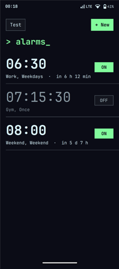
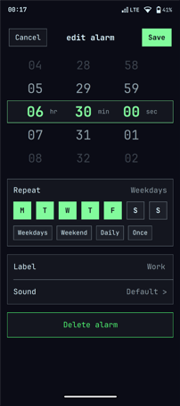
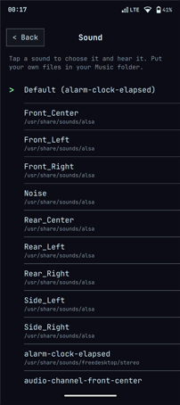
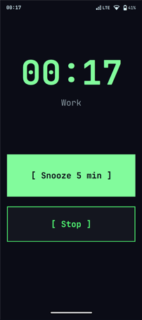

# kloot-wecker

A small alarm clock for Linux phones, built on Omarchy Mobile: a Qt Quick
app (run by [Quickshell](https://quickshell.org), GPU-rendered) in the
Omarchy look (square, monospace, thin borders) with scroll wheels for hours,
minutes and seconds, a user service that rings,
and a ring screen with **Snooze (5 min)** and **Stop**.
It takes its colors from the current Omarchy theme
(`~/.local/state/omarchy/current/theme/colors.toml`) and follows a theme switch
within two seconds. Times are the phone's local time. Without Quickshell it falls back to a
terminal UI in [foot](https://codeberg.org/dnkl/foot) (`kloot-wecker tui`).

| Alarms | Edit | Sound | Ringing |
| --- | --- | --- | --- |
|  |  |  |  |

- New alarms start at 08:00. Several alarms, each with a time and weekdays (none = once, then it turns
  itself off), on/off, edit, delete, and a 5-second test.
- **Your own sound per alarm:** in the alarm editor, tap **Sound** and pick an
  audio file (mp3, ogg, opus, flac, wav, m4a …) from your music folder
  (`~/Music` or the XDG music dir), `~/.local/share/sounds` or
  `/usr/share/sounds`. Tapping a sound chooses it and plays it.
  Without a choice the default sound rings (see below).
- Ringing: lights the screen (`omarchy-shell lock wake`, repeated so it stays
  on), loops the sound with `mpv`, volume ramps from 35 % to 85 % over 40 s
  and is restored afterwards; stops by itself after 15 minutes. If the file
  can't be played it falls back to the freedesktop alarm sound.

## Install

```
git clone https://github.com/den-kloot/kloot-wecker
cd kloot-wecker && ./install.sh   # program, user service, app-menu entry
```

Needs Python 3, Quickshell (Qt 6), mpv and wpctl (PipeWire); foot only for the fallback. The screen wake and the
ring window use Omarchy Mobile's `omarchy-shell` and `omamobile-launch`.

## Use

- App menu: **Alarm clock**. Or `kloot-wecker` in a terminal.
- `kloot-wecker tui | list | stop | snooze | sounds | ring [--sound FILE] [--no-window] [LABEL]`
- Alarms: `~/.config/kloot-wecker/alarms.json`.
- Settings: `~/.config/kloot-wecker/wecker.env`:
  `SOUND=` (default sound for alarms without their own), `VOLUME_START=`,
  `VOLUME_END=`, `RAMP_SECONDS=`.

## Limits

The phone has to be awake at alarm time: there's no RTC wake from suspend yet.
On the Pixel 9a the phone doesn't suspend while the modem runs, so it works
there today.

License: MIT.
